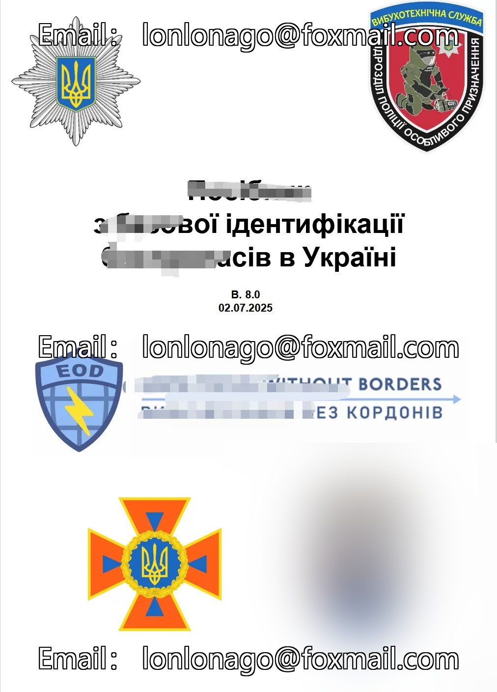
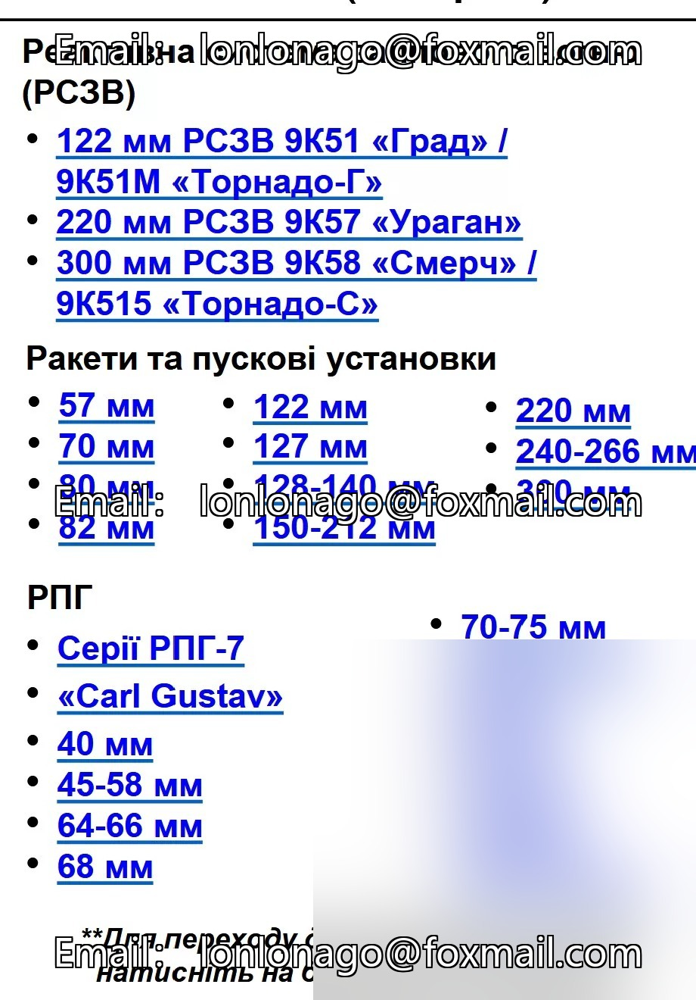
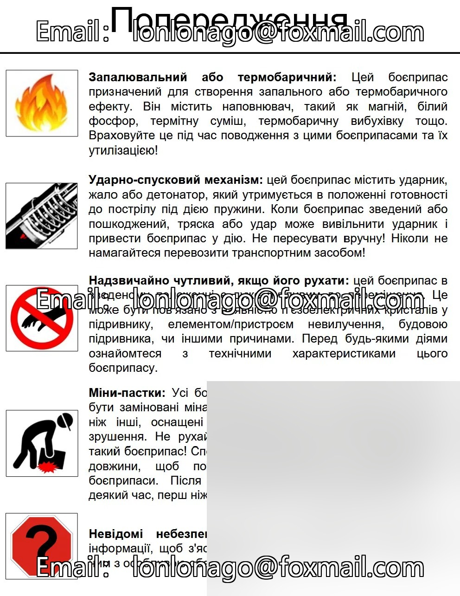
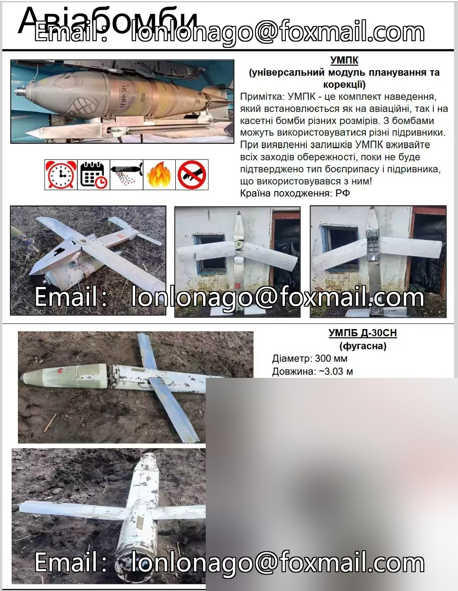
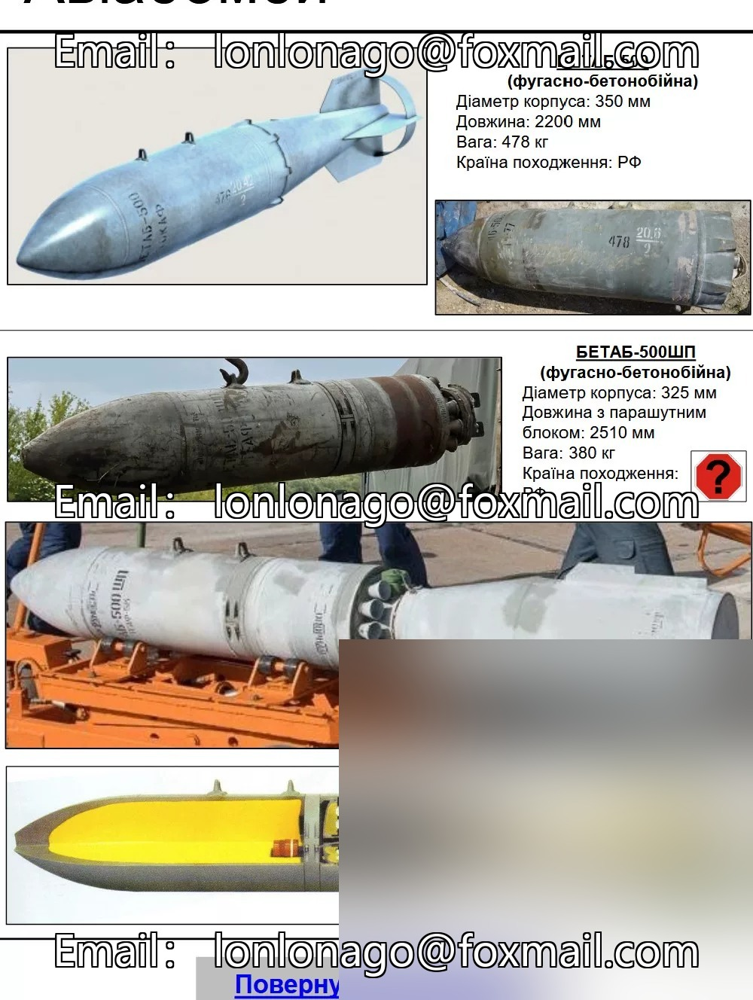
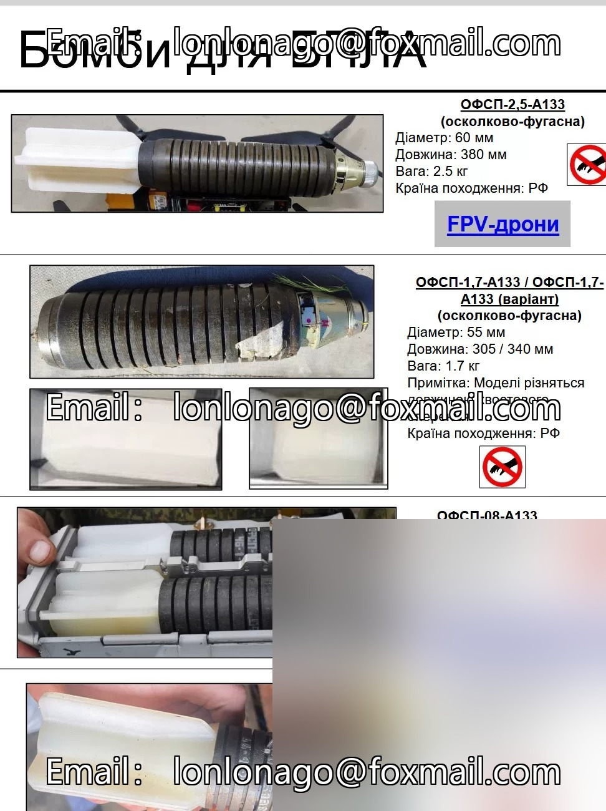
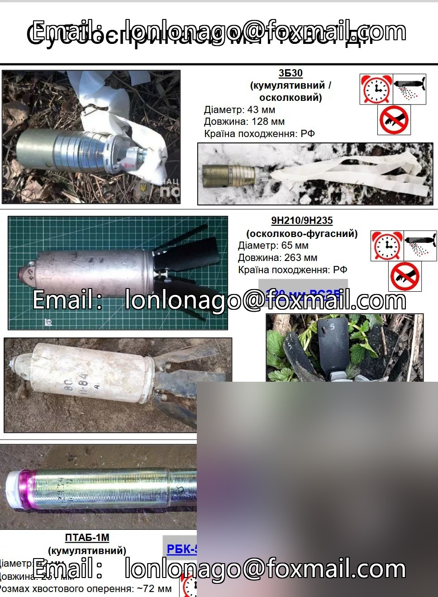
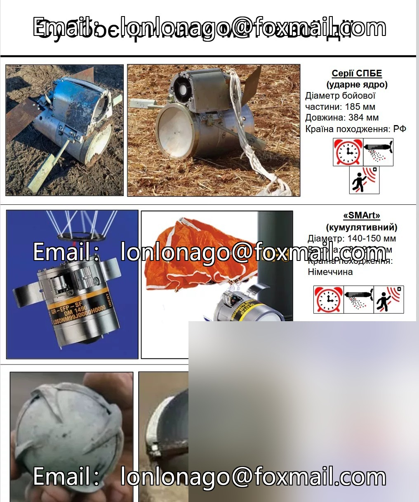

# #Russo-Ukrainian War Ukrainian ammunition identification manual 2025 edition.

## Body

#Russian-Ukrainian War Ukraine Ammunition Recognition Manual 2025 Edition.
I. Main Content
1. Recognition standards for various types of ammunition
2. Classification recognition for rocket shells, shells, mortars, etc.
3. Recognition for new types of ammunition such as drones' bombs and aerial bombs
4. Safety guidelines for handling explosives
5. Recognition process and precautions
II. Document Features
Authority: Written by a professional counter-terrorism agency to ensure information accuracy
Practicality: Rich in illustrations and text, facilitating quick recognition
Comprehensiveness: Covers all types of ammunition, including traditional and new
Target audience: Military enthusiasts, professionals, and counter-terrorism agencies
The are copyable and not returned upon sale.

The 2025 Ukrainian ammunition identification manual covers recognition standards, classification, new types of ammunition, explosion handling safety, and identification procedures with authority, practicality, comprehensiveness and replicability, applicable to military enthusiasts, professionals and counter-terrorism agencies.

<!-- AI_ENRICHED -->

## Images

## Payment

Here is a pay link on Stripe ( https://buy.stripe.com/3cs8yP7sY87d0vu9AB ). Please contact me lonlonago@foxmail.com after funding $89, and I will send you a complete data files , thank you!

